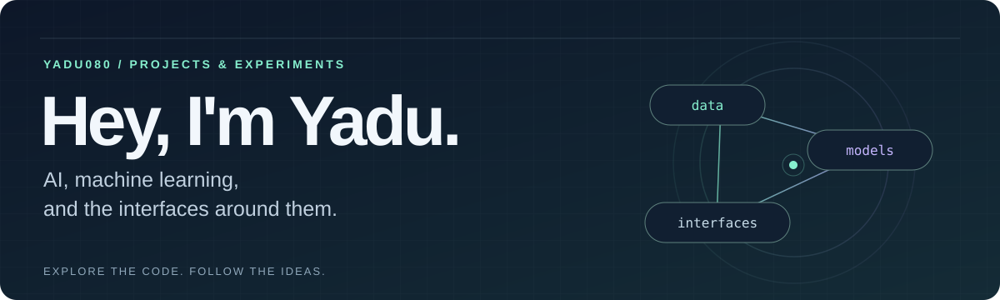

  

  <b>Yadunandan M Nimbalkar</b> 
  Building with Python, exploring machine learning, and bringing it into web apps.

  <a href="#selected-projects">Selected projects</a> &nbsp; / &nbsp;
  <a href="#tools-in-my-repos">Tools in my repos</a> &nbsp; / &nbsp;
  <a href="https://github.com/Yadu080?tab=repositories">All repositories ↗</a>

---

My projects span **code search, recommendation systems, multimodal experiments, and data visualization**. I work across the model, the API, and the interface—turning ideas into applications you can explore in the repositories below.

## Selected projects

<table>
<tr>
<td width="50%" valign="top">
<h3>01 / AI Codebase Analyzer</h3>

Ask questions about a GitHub repository using retrieved source-code snippets as context for an LLM.

<code>Python</code> <code>FastAPI</code> <code>Next.js</code> <code>FAISS</code>

<a href="https://github.com/Yadu080/AI-Codebase-Analyzer"><b>Explore the code →</b></a>

</td>
<td width="50%" valign="top">
<h3>02 / MusicDNA</h3>

Explore music taste through genre profiles, listening-history analysis, and an interactive 3D artist galaxy.

<code>Next.js</code> <code>TypeScript</code> <code>Three.js</code> <code>FastAPI</code>

<a href="https://github.com/Yadu080/musicdna"><b>Explore the code →</b></a>

</td>
</tr>
<tr>
<td width="50%" valign="top">
<h3>03 / RECOMAI</h3>

A movie recommender pairing two-tower neural retrieval with gradient-boosted re-ranking and a React interface.

<code>PyTorch</code> <code>scikit-learn</code> <code>FastAPI</code> <code>React</code>

<a href="https://github.com/Yadu080/Two-Tower_Recommendation_System"><b>Explore the code →</b></a>

</td>
<td width="50%" valign="top">
<h3>04 / ModelHunter</h3>

A dashboard for evaluating ML models with adversarial attacks, defense experiments, and downloadable reports.

<code>PyTorch</code> <code>FastAPI</code> <code>React</code> <code>SQLAlchemy</code>

<a href="https://github.com/Yadu080/Model_Hunter"><b>Explore the code →</b></a>

</td>
</tr>
<tr>
<td width="50%" valign="top">
<h3>05 / MoodScript</h3>

A journaling app experimenting with text and facial emotion classification, calibrated fusion, and conversational responses.

<code>Python</code> <code>FastAPI</code> <code>React</code> <code>Transformers</code>

<a href="https://github.com/Yadu080/MoodScript"><b>Explore the code →</b></a>

</td>
<td width="50%" valign="top">
<h3>06 / Silence Engine</h3>

A monitoring prototype that separates potential service-access gaps from reporting failures, demonstrated on synthetic data.

<code>Python</code> <code>Flask</code> <code>SQLite</code> <code>TypeScript</code>

<a href="https://github.com/Yadu080/silence-engine"><b>Explore the code →</b></a>

</td>
</tr>
</table>

## Tools in my repos

| Area | Technologies used in the projects above |
| :--- | :--- |
| Languages | Python · TypeScript · JavaScript |
| ML & retrieval | PyTorch · scikit-learn · SentenceTransformers · FAISS |
| APIs & data | FastAPI · Flask · SQLite · SQLAlchemy |
| Interfaces | React · Next.js · Three.js · Tailwind CSS |

<b>Under the hood — a few places to start reading</b>

- **Codebase Analyzer:** [How retrieved code becomes LLM context](https://github.com/Yadu080/AI-Codebase-Analyzer/blob/main/app/qa_engine.py).
- **MusicDNA:** [How genres become a taste vector](https://github.com/Yadu080/musicdna/blob/main/backend/ml/taste.py).
- **RECOMAI:** [The two-tower model](https://github.com/Yadu080/Two-Tower_Recommendation_System/blob/main/ml/models/two_tower.py) and [the ranking pipeline](https://github.com/Yadu080/Two-Tower_Recommendation_System/blob/main/ml/scripts/train_ranker.py).
- **ModelHunter:** [The adversarial attack registry](https://github.com/Yadu080/Model_Hunter/blob/main/backend/app/attacks/registry.py).
- **MoodScript:** [The calibrated fusion layer](https://github.com/Yadu080/MoodScript/blob/main/models/fusion.py).
- **Silence Engine:** [How evidence becomes a triage hypothesis](https://github.com/Yadu080/silence-engine/blob/main/backend/silence_engine/triage.py).

---

  <b>From an idea to a model to an interface.</b> 
  <a href="https://github.com/Yadu080?tab=repositories">Browse my repositories ↗</a>

