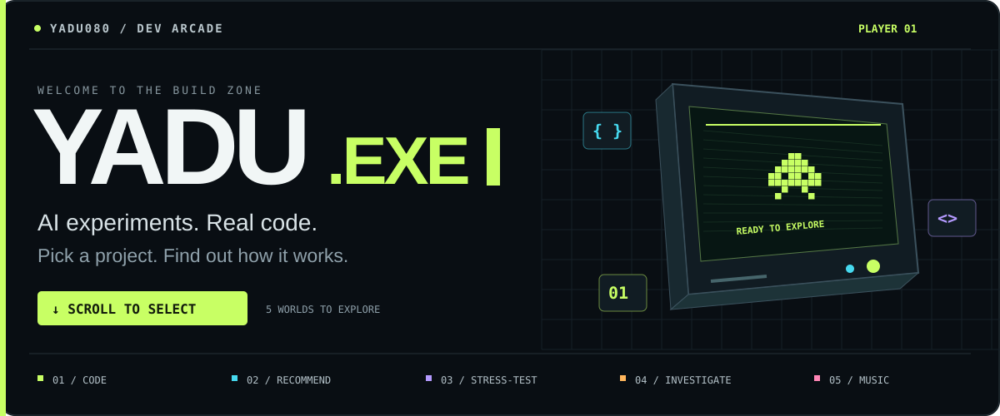
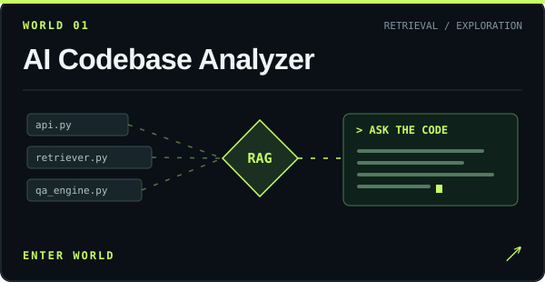
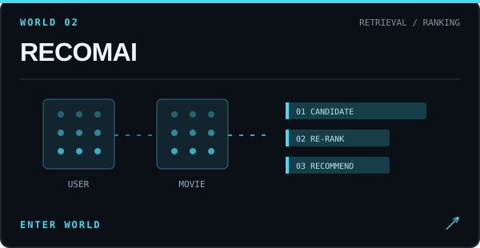
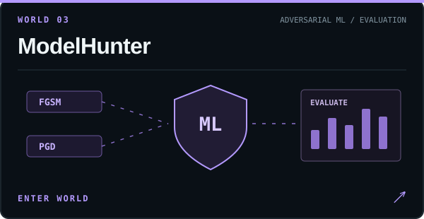
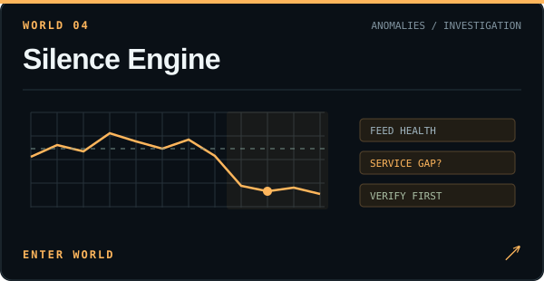
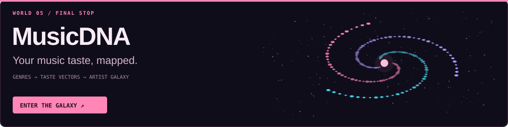
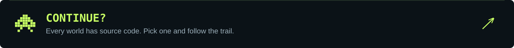

  

  <b>Yadunandan M Nimbalkar · @Yadu080</b> 
  I build AI tools, recommendation systems, and the interfaces that make them explorable.

  <a href="#world-select"><b>▶ START EXPLORING</b></a> &nbsp; · &nbsp;
  <a href="#the-inventory">OPEN INVENTORY</a> &nbsp; · &nbsp;
  <a href="#source-code-challenge">TAKE THE CHALLENGE</a>

 

  <code>Python</code> &nbsp; <code>TypeScript</code> &nbsp; <code>JavaScript</code> 
  <code>PyTorch</code> &nbsp; <code>scikit-learn</code> &nbsp; <code>SentenceTransformers</code> &nbsp; <code>FAISS</code> 
  <code>FastAPI</code> &nbsp; <code>Flask</code> &nbsp; <code>SQLite</code> &nbsp; <code>SQLAlchemy</code> 
  <code>React</code> &nbsp; <code>Next.js</code> &nbsp; <code>Three.js</code> &nbsp; <code>Tailwind CSS</code>

 

<table>
<tr>
<td width="50%" valign="top">

<b>The mission:</b> understand an unfamiliar codebase. Ask questions with retrieved source-code snippets supplied as context to an LLM.

<code>FastAPI</code> <code>Next.js</code> <code>FAISS</code>

<a href="https://github.com/Yadu080/AI-Codebase-Analyzer"><b>▶ Explore</b></a> · <a href="https://github.com/Yadu080/AI-Codebase-Analyzer/blob/main/app/qa_engine.py">Inspect the Q&amp;A engine</a>

</td>
<td width="50%" valign="top">

<b>The mission:</b> find the next movie. Combine two-tower neural retrieval with gradient-boosted re-ranking and a React interface.

<code>PyTorch</code> <code>scikit-learn</code> <code>React</code>

<a href="https://github.com/Yadu080/Two-Tower_Recommendation_System"><b>▶ Explore</b></a> · <a href="https://github.com/Yadu080/Two-Tower_Recommendation_System/blob/main/ml/models/two_tower.py">Inspect the two towers</a>

</td>
</tr>
<tr>
<td width="50%" valign="top">

<b>The mission:</b> stress-test a model. Explore adversarial attacks, defense experiments, and downloadable evaluation reports.

<code>PyTorch</code> <code>FastAPI</code> <code>SQLAlchemy</code>

<a href="https://github.com/Yadu080/Model_Hunter"><b>▶ Explore</b></a> · <a href="https://github.com/Yadu080/Model_Hunter/blob/main/backend/app/attacks/registry.py">Inspect the attack registry</a>

</td>
<td width="50%" valign="top">

<b>The mission:</b> investigate missing activity. Triage potential service-access gaps and reporting failures in a prototype demonstrated on synthetic data.

<code>Python</code> <code>Flask</code> <code>SQLite</code>

<a href="https://github.com/Yadu080/silence-engine"><b>▶ Explore</b></a> · <a href="https://github.com/Yadu080/silence-engine/blob/main/backend/silence_engine/triage.py">Inspect the triage rules</a>

</td>
</tr>
</table>

**The mission:** explore music taste through genre profiles, listening-history analysis, and an interactive 3D artist galaxy.

<code>Next.js</code> <code>TypeScript</code> <code>Three.js</code> <code>FastAPI</code>

[**▶ Explore MusicDNA**](https://github.com/Yadu080/musicdna) · [Inspect the taste-vector engine](https://github.com/Yadu080/musicdna/blob/main/backend/ml/taste.py)

 

Choose an answer to reveal the result. Give yourself one point for each correct first pick; the linked code is the answer key.

**ROUND 01 · What does Codebase Analyzer send to the LLM alongside your question?**

A · Retrieved code chunks and their file paths

<strong>✓ Correct.</strong> <code>generate_answer</code> builds context from each chunk's <code>file_path</code> and <code>chunk</code>, then places that context in the prompt with your question.

<a href="https://github.com/Yadu080/AI-Codebase-Analyzer/blob/main/app/qa_engine.py">Inspect the answer →</a>

B · Only the repository name

<strong>Try the other route.</strong> The prompt includes retrieved source snippets and their paths, giving the model code to work from.

<a href="https://github.com/Yadu080/AI-Codebase-Analyzer/blob/main/app/qa_engine.py">Follow the context construction →</a>

**ROUND 02 · Which model re-ranks RECOMAI's retrieved candidates?**

A · A second large language model

<strong>Try the other route.</strong> The ranking script imports <code>GradientBoostingClassifier</code> from scikit-learn.

<a href="https://github.com/Yadu080/Two-Tower_Recommendation_System/blob/main/ml/scripts/train_ranker.py">Read the ranking pipeline →</a>

B · A gradient-boosted classifier

<strong>✓ Correct.</strong> The ranker scores user–movie pairs using engineered features such as embedding similarity and genre overlap.

<a href="https://github.com/Yadu080/Two-Tower_Recommendation_System/blob/main/ml/scripts/train_ranker.py">Inspect the answer →</a>

**ROUND 03 · A service's recorded activity drops. Does that alone prove a service-access gap?**

A · Yes — low activity is sufficient proof

<strong>Try the other route.</strong> Missing or degraded reporting can also produce a drop. Silence Engine treats its categories as hypotheses for human verification.

<a href="https://github.com/Yadu080/silence-engine/blob/main/backend/silence_engine/triage.py">Read the triage rules →</a>

B · No — investigate feed health and other evidence

<strong>✓ Correct.</strong> The system distinguishes potential access gaps, reporting problems, expected variation, and uncertain cases.

<a href="https://github.com/Yadu080/silence-engine/blob/main/backend/silence_engine/triage.py">Inspect the answer →</a>

Score yourself: 1/3 · Explorer &nbsp; / &nbsp; 2/3 · Code detective &nbsp; / &nbsp; 3/3 · Source navigator

 

<a href="#world-select">↑ Back to world select</a> · <a href="https://github.com/Yadu080?tab=repositories">All repositories ↗</a>

